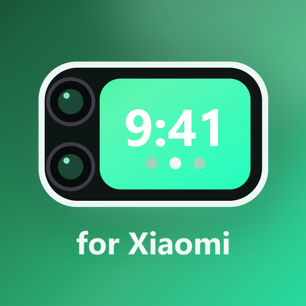
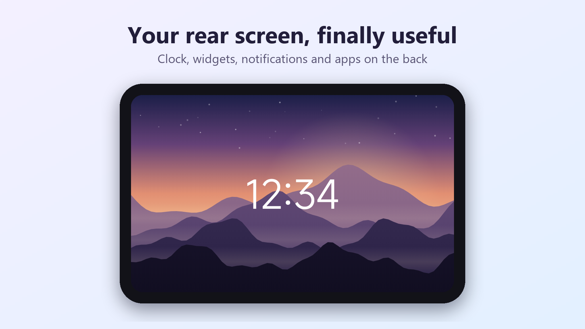
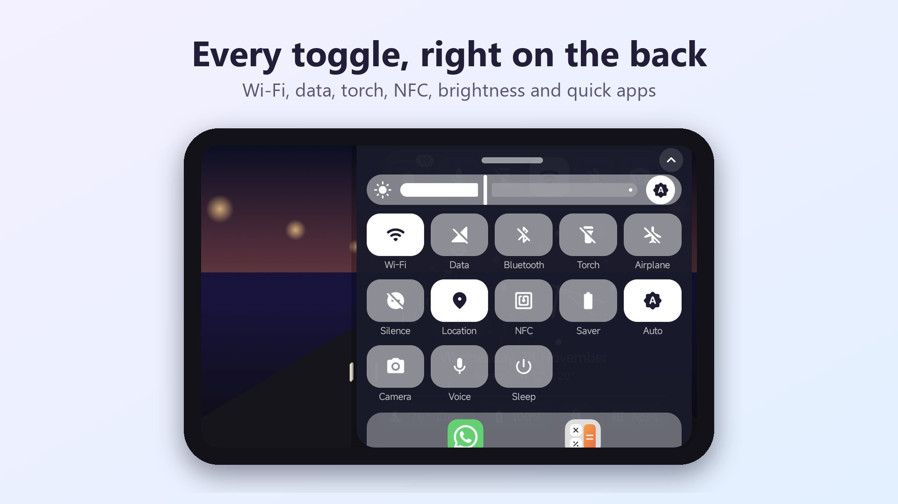
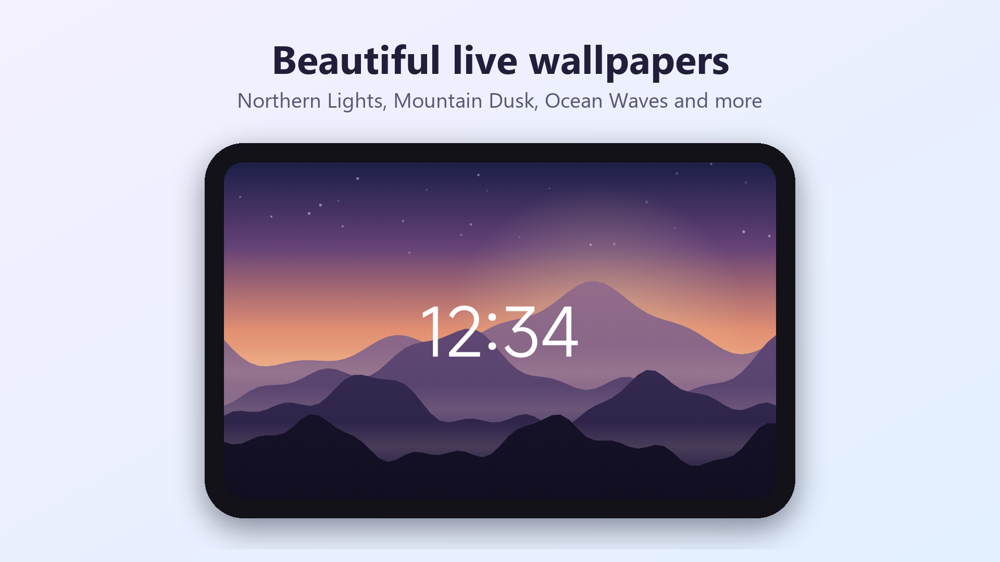
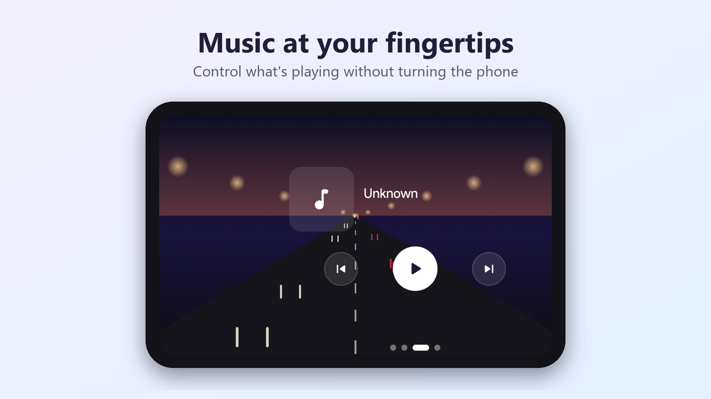
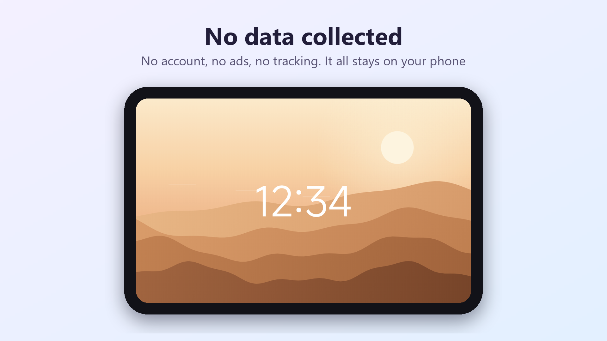

<p align="center">
  
</p>

<h1 align="center">BackDisplay</h1>

<p align="center">
  <b>Your Xiaomi rear screen, finally useful.</b><br>
  Clocks, notifications, calls, widgets and your own apps on the back of the Xiaomi 17 Pro, 17 Pro Max, 18 Pro and 18 Pro Max.<br>
  Free · no ads · no account · no data collected
</p>

<p align="center">
  <a href="https://github.com/Matrixology/backdisplay/releases/latest/download/BackDisplay.apk"><b>⬇ Download the latest APK</b></a>
  &nbsp;·&nbsp;
  <a href="https://matrixology.github.io/backdisplay/">Website</a>
  &nbsp;·&nbsp;
  <a href="https://matrixology.github.io/backdisplay/#support">Support the app</a>
  &nbsp;·&nbsp;
  <a href="https://github.com/Matrixology/backdisplay/releases">All releases</a>
</p>

<p align="center">
  
</p>

---

## Features

**Clocks and always-on**
- Digital and analog clock faces, up to three world clocks
- Weather with warnings, battery level and an always-on page
- Moving and still backgrounds

**Calls from the back**
- Answer or decline phone calls and WhatsApp calls on the rear screen
- Shows which app is calling (Phone, WhatsApp, WhatsApp Business)
- Speaker and hang-up buttons, with glowing edges while it rings

**Notifications**
- New notifications light up the rear screen, then it goes back to sleep
- Optional: show them only while the phone isn't in use
- Music controls, alarm cards with Snooze and Stop, live cards for deliveries and navigation

**Your apps on the rear**
- Open any app on the back, each with its own size and brightness
- The keyboard works on the rear screen too

**Reminders**
- Share anything from the front screen to the rear as a reminder
- Once or repeating, with Snooze and Done

**Battery and device**
- Battery health, heat warning, memory and storage
- Charging animation when you plug in

**Widgets**
- Quick toggles, flights (with an alert 12 hours before take-off), stocks, crypto prices, weather
- Live IP cameras: Hikvision, Dahua, IMOU
- Swipeable pages

**Face wake and pocket mode**
- The rear wakes when you look at it, and stays on while you do
- Stays dark in your pocket or when the phone lies face-down
- Rear face unlock and PIN, so the back stays private
- All processed on the phone

**HyperOS push fix**
- On-time WhatsApp, Gmail and Telegram notifications on China HyperOS, without root

**Languages:** English, 中文 (简体), हिन्दी, العربية, Deutsch, Français, Español

<p align="center">
  
  
</p>
<p align="center">
  
  
</p>

## Supported phones

| Phone | Status |
|---|---|
| Xiaomi 17 Pro | ✅ |
| Xiaomi 17 Pro Max | ✅ |
| Xiaomi 18 Pro | ✅ |
| Xiaomi 18 Pro Max | ✅ |

Android 14 or newer, HyperOS. On phones without a rear screen the app does nothing.

## Install

1. **Download** [`BackDisplay.apk`](https://github.com/Matrixology/backdisplay/releases/latest/download/BackDisplay.apk) on the phone. If Android asks, allow your browser to install apps.
2. **Install Shizuku if you're on stock HyperOS.** [Shizuku](https://play.google.com/store/apps/details?id=moe.shizuku.privileged.api) is free on Google Play. On **xiaomi.eu** and **ZKOS** ROMs you can skip this step (see below).
3. **Open BackDisplay and follow its guide.** It checks your ROM, helps you start Shizuku if it's needed, and asks for the few permissions it uses (notifications, calls, microphone, camera, display over apps, battery).
4. **Turn the phone over.** Pick a clock and a background, and add the apps and widgets you want on the back.

### Do I need Shizuku?

| ROM | Shizuku |
|---|---|
| Stock HyperOS (China / Global) | **Required.** HyperOS only lets system-level tools put apps on the rear screen. Shizuku gives BackDisplay that access without root. |
| xiaomi.eu, ZKOS | **Optional.** The ROM opens apps on the rear by itself. Shizuku adds extras such as pausing Xiaomi's own rear app and App Lock handling. |

BackDisplay detects the ROM by itself. If it guesses wrong, use the switch **"Rear screen works without Shizuku"** on its Home screen.

On stock HyperOS, Shizuku has to be started again after every reboot: open Shizuku and tap **Start** (via Wireless debugging). Pairing is only needed once.

### Updating

Download the new APK from [Releases](https://github.com/Matrixology/backdisplay/releases/latest) and install it over the old one. Your settings are kept.

### Check the download (optional)

Each release lists the SHA-256 checksum of `BackDisplay.apk`. On a PC:

```
certutil -hashfile BackDisplay.apk SHA256      # Windows
sha256sum BackDisplay.apk                      # Linux / macOS
```

## Troubleshooting

- **Nothing shows on the rear screen (stock HyperOS):** Shizuku isn't running. Open Shizuku and tap Start, then reopen BackDisplay.
- **Xiaomi's own rear screen keeps coming back:** on the Home screen, pause "Xiaomi rear app" (needs Shizuku; nothing is deleted, and you can restore it with one tap).
- **Late notifications on China HyperOS:** use the HyperOS push fix in the app.
- **After a HyperOS update something stopped working:** a system update can change what is allowed. Check for a new BackDisplay release. Turning off automatic HyperOS updates avoids surprises.
- **Something else:** in the app, tap **Report a problem**. Your email app opens with a short technical log; nothing is sent until you press Send.

## Privacy

No account, no ads, no analytics, no tracking. Your settings, face data and notifications stay on the phone. The app only fetches public data you ask for (weather, prices). Full policy: [privacy.html](https://matrixology.github.io/backdisplay/privacy.html).

## Support BackDisplay

BackDisplay is free and made by one developer. If it makes your phone better, any amount helps pay for new features and for fixes after HyperOS updates. Binance Pay, USDT, card, monthly support and Pakistani mobile wallets are on the website:

👉 **[matrixology.github.io/backdisplay/#support](https://matrixology.github.io/backdisplay/#support)**

## About this repository

This repository hosts the BackDisplay website (GitHub Pages) and the APK downloads (Releases). The app's source code isn't published here. To report a problem, use **Report a problem** in the app, or [open an issue](https://github.com/Matrixology/backdisplay/issues).

BackDisplay is an independent app. It is not affiliated with Xiaomi, Google or Shizuku. Xiaomi and HyperOS are trademarks of their owners.
